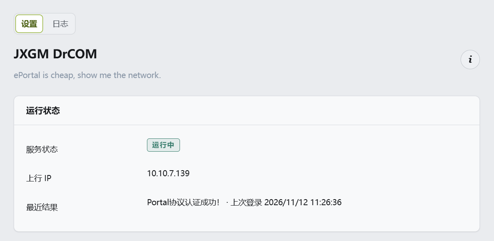

# JXGMDrcom

[](LICENSE)
[](https://github.com/wmrasw/JXGMDrcom/releases)
[](https://github.com/wmrasw/JXGMDrcom/actions/workflows/build.yml)

**English** | [中文](README.md)

Automatic **Dr.COM (City Hotspot) campus network** login for OpenWrt, packaged as a
LuCI application. Authentication is a single `curl` call to the ePortal web API;
the package is pure shell + JavaScript and builds no binaries.

The portal URL, ISP suffix and `v` parameter are configurable, so it may work for
other schools that also use Dr.COM ePortal.

## Compatibility

| Firmware | Package manager | File |
| --- | --- | --- |
| OpenWrt 24.10 and earlier, ImmortalWrt, Kwrt | opkg | `luci-app-jxgm-drcom_<version>-r1_all.ipk` |
| OpenWrt 25.12 and later | apk | `luci-app-jxgm-drcom-<version>-r1.apk` |

The package is independent of the CPU architecture (`all` / `noarch`), so the same
file works on every device.

This plugin implements **ePortal web authentication only**. Dr.COM's P (PPPoE) and
X (802.1X) client authentication modes are not supported.

## Features

- **procd service**: probes the internet (HTTP 204) on an interval and only logs in
  when offline; failed logins are retried, consecutive failures enter a cooldown
- **Fully configurable portal request**: portal URL, ISP suffix, device type
  (account prefix + `terminal_type` pairing), `v` parameter, User-Agent, real or
  placeholder MAC
- **State and log**: `/var/run/drcom.state` (status, last login, last result) and
  `/var/log/drcom.log` with rotation
- **LuCI pages**: status, login/restart/stop, three configuration tabs, log page
  with pause and clear
- **Portal diagnostics**: editing the connectivity URL probes it automatically;
  uplink IP and uplink MAC are displayed
- **Optional MAC change**: writes the uplink MAC to `/etc/config/network` and
  reloads the network (with confirmation)
- **Chinese / English UI**: follows the system language; translations ship inside
  the package
- **About dialog**: the ⓘ button in the page header shows name, version, license,
  contributors and test information
- **Manual logout**: "Log out" stops the service and sends an unbind request to the
  portal, handy when switching accounts
- **Config error protection**: a wrong password or unknown account pauses the
  service, and saving the configuration resumes it

## Screenshot



## Installation

### Option 1: install a release package

Download the matching file from [Releases](https://github.com/wmrasw/JXGMDrcom/releases):

```sh
# opkg (OpenWrt 24.10 and earlier, ImmortalWrt, Kwrt)
opkg install /tmp/luci-app-jxgm-drcom_1.0.3-r1_all.ipk

# apk (OpenWrt 25.12 and later)
apk add --allow-untrusted /tmp/luci-app-jxgm-drcom-1.0.3-r1.apk

/etc/init.d/drcom enable
/etc/init.d/drcom start
```

Then open **Services → JXGM DrCOM**, fill in the student ID (e.g. `T202XXXXX`),
password and ISP, enable autostart and apply.

### Option 2: build as a feed

```sh
echo 'src-git jxgmdrcom https://github.com/wmrasw/JXGMDrcom.git' >> feeds.conf.default
./scripts/feeds update jxgmdrcom
./scripts/feeds install -a -p jxgmdrcom
make menuconfig      # LuCI -> Applications -> luci-app-jxgm-drcom
make -j$(nproc)
```

### Option 3: copy into the source tree / SDK

```sh
./scripts/feeds update -a && ./scripts/feeds install -a
cp -r luci-app-jxgm-drcom package/
make package/luci-app-jxgm-drcom/compile V=s
# opkg tree: bin/packages/<arch>/luci/luci-app-jxgm-drcom_<version>-r1_all.ipk
# apk tree:  bin/packages/<arch>/luci/luci-app-jxgm-drcom-<version>-r1.apk
```

> The Makefile searches `$(TOPDIR)/feeds/*/luci.mk`, so trees that rename the
> luci feed (Kwrt) still build. Without luci.mk it falls back to its own install
> rules, which keeps SDK builds working.

### Option 4: build an ipk without the SDK

`tools/mkipk.py` writes an opkg-format archive and only needs Python:

```sh
python tools/mkipk.py
# dist/luci-app-jxgm-drcom_<version>-r1_all.ipk
```

## Configuration

| Option | Default | Description |
| --- | --- | --- |
| `enabled` | 0 | Start on boot; manual start/restart is not affected |
| `username` | empty | Student ID, e.g. `T202XXXXX` |
| `password` | empty | Password |
| `operator` | empty | `unicom` / `cmcc` / `telecom` or a custom value; **empty adds no `@` suffix** |
| `iface` | `wan` | Uplink interface (device list in the UI) |
| `portal_url` | school portal | ePortal login URL |
| `check_url` | miui 204 | Connectivity check URL; the page probes it after edits |
| `interval` | 300 | Seconds between connectivity checks |
| `retry_interval` | 15 | Seconds between login retries |
| `max_attempts` | 3 | Consecutive failures before entering cooldown |
| `cooldown` | 300 | Cooldown length in seconds |
| `connect_timeout` | 5 | Request timeout in seconds |
| `use_real_mac` | `0` | Send the uplink MAC instead of all zeros |
| `device_type` | `pc` | `pc`=`,0,` + `terminal_type` 1; `mobile`=`,1,` + 2 |
| `v` | `7911` | `v` parameter sent to the portal |
| `v_random` | `0` | Send a random 4-digit `v` on every login |
| `user_agent` | empty | Empty uses curl's default UA (shown in the placeholder) |
| `ignore_config_error` | `0` | Keep retrying on configuration errors (default: pause, resume after saving) |
| `log_level` | `info` | error / warn / info / debug |

## Command line

```sh
/usr/share/drcom/drcom.sh run            # daemon loop: check -> login -> wait
/usr/share/drcom/drcom.sh once           # check, log in only when offline
/usr/share/drcom/drcom.sh login          # skip the 204 check, send one login request
/usr/share/drcom/drcom.sh logout         # send an unbind request to the portal
/usr/share/drcom/drcom.sh check          # exit 0 when online, 1 when offline
/usr/share/drcom/drcom.sh probe <url>    # print the HTTP status code (000 = unreachable)
/usr/share/drcom/drcom.sh ip             # print the uplink IPv4 address
/usr/share/drcom/drcom.sh mac            # print the real uplink MAC
/usr/share/drcom/drcom.sh set-mac <mac>  # write /etc/config/network and reload (brief outage)
```

## FAQ

**Login rejected (`login rejected: ...`)**

Read the `msg` text: wrong password, mismatched ISP and malformed account are all
echoed back. The log lives in `/var/log/drcom.log`; `drcom.sh login` reproduces a
single attempt from SSH.

**Will it keep retrying after a wrong password, unknown account or missing ISP?**

No, not by default. Those are configuration problems: `drcom.sh run` pauses (no
more requests to the portal), the page shows **Paused**, and the log plus "Last
result" show the portal message. Saving the configuration resumes the service
automatically, no reboot required.

To keep retrying instead, tick **Keep retrying on config errors** under Advanced.

**"IP already online"**

The session for that egress IP is still valid, which is normal. Use **Log out**
first, then log in again with the new account or ISP.

**"This account was detected using sharing software or a router ... 180 s"**

Dr.COM's anti-sharing detection. The trailing number is the remaining cooldown;
logging in during it returns the same message, and it clears automatically. The
plugin records the remaining seconds in the log and "Last result"; nothing to do.

**The page shows "Paused"**

The configuration error protection is active: "Last result" holds the portal
message (e.g. `密码错误`), and no requests are sent. Correct the password, account
or ISP and save; the service resumes automatically.

**The page shows "Stopped"**

Check `username`/`password` in `/etc/config/drcom`, `uci get drcom.main.enabled`,
and look for errors such as `username or password missing` in
`/var/log/drcom.log`.

**Logs and state are empty after a reboot**

`/var/log/drcom.log` and `/var/run/drcom.state` live in tmpfs (`/var`) and are
cleared on purpose.

**No internet after changing the MAC**

Write the original MAC back and press Apply again; the current value is shown in
"Uplink MAC".

**Uninstall**

```sh
opkg remove luci-app-jxgm-drcom     # or: apk del luci-app-jxgm-drcom
rm -f /etc/config/drcom             # also remove the configuration
```

## Repository layout

```
JXGMDrcom/
├── LICENSE                  # Apache License 2.0
├── NOTICE                   # copyright and trademark notice
├── LICENSES/                # both license texts (code Apache-2.0, docs CC BY 4.0)
├── AGENTS.md                # project notes for AI coding agents
├── CHANGELOG.md
├── screenshots/
├── tools/
│   ├── mkdeploy.py          # deployment tarball for manual testing
│   ├── mkipk.py             # build an ipk without the SDK
│   ├── lmo.py               # .po -> LuCI .lmo compiler
│   └── build-i18n.py        # regenerate the catalogs under root/
└── luci-app-jxgm-drcom/     # package, ready for an OpenWrt source tree
    ├── Makefile
    ├── po/en/luci-app-jxgm-drcom.po
    ├── htdocs/luci-static/resources/view/drcom/
    │   ├── overview.js      # status, login, start/stop, settings
    │   └── log.js           # log viewer (5 s polling)
    └── root/
        ├── etc/config/drcom           # defaults (conffile, 600)
        ├── etc/init.d/drcom           # procd service
        ├── etc/uci-defaults/95-drcom  # tighten permissions on install
        ├── usr/share/drcom/drcom.sh   # login logic
        ├── usr/share/luci/menu.d/luci-app-jxgm-drcom.json
        ├── usr/share/rpcd/acl.d/luci-app-jxgm-drcom.json
        └── usr/lib/lua/luci/i18n/luci-app-jxgm-drcom.en.lmo
```

## Related projects

- [mchome/dogcom](https://github.com/mchome/dogcom) — C implementation of the Dr.COM 802.1X protocol
- [drcoms/drcom-generic](https://github.com/drcoms/drcom-generic) — protocol parameters and captures
- [sweetcornna/jlu_drcom](https://github.com/sweetcornna/jlu_drcom) — Dr.COM packaged as an OpenWrt service
- [Barabama/RuijieEportal](https://github.com/Barabama/RuijieEportal) — Ruijie ePortal login script
- [ken-arch/drcom-](https://github.com/ken-arch/drcom-) — minimal Dr.COM auto login script

This project targets web authentication (ePortal) and shares no code with them.

## Tested on

Verified on Kwrt 25.12-SNAPSHOT (kernel 6.12):

- automatic login after going offline (`Portal协议认证成功!`)
- manual login / restart / stop
- the service recovers after a reboot
- procd restarts the instance when the configuration changes
- **Log out** unbinds the terminal (`解绑终端MAC成功!`)
- the sharing-detection message reports the remaining seconds in the log
- the status page reads online time and traffic (traffic follows the portal's accounting interval)

## Known limitations

- files deployed by hand are not in the package database and disappear on a
  firmware upgrade;
- the portal protocol may change with a school-side upgrade, in which case the
  request parameters need adjusting;
- traffic figures on the status page are aggregated by the portal and may lag a
  few minutes;
- portal detection only works while logged out (behind the captive portal).

## Changelog

See [CHANGELOG.md](CHANGELOG.md).

## License

- **Code** (`luci-app-jxgm-drcom/`, `tools/`, `.github/`) is released under the
  [Apache License 2.0](LICENSE), with a [NOTICE](NOTICE) file;
- **Documentation and screenshots** (`README.md`, `README.en.md`, `CHANGELOG.md`,
  `screenshots/`) are released under [CC BY 4.0](LICENSES/CC-BY-4.0.txt).

- This is an **unofficial** plugin, not affiliated with Guangzhou Hotspot Software
  Technology Co., Ltd. or any school IT center;
- "Dr.COM", "ePortal" and other product names are trademarks of their respective
  owners and are used only to describe compatibility;
- The plugin only automates an existing campus login, it does not crack accounts
  or provide free internet access.
