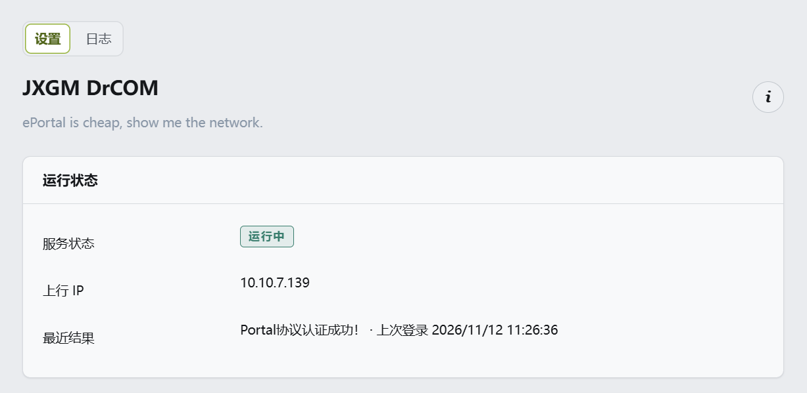

# JXGMDrcom

[](LICENSE)
[](https://github.com/wmrasw/JXGMDrcom/releases)
[](https://github.com/wmrasw/JXGMDrcom/actions/workflows/build.yml)

**中文** | [English](README.en.md)

江西工业贸易职业技术学院 **Dr.COM 城市热点校园网**的 OpenWrt LuCI 自动登录插件。
认证走 `curl`（ePortal 网页认证），纯脚本 + 前端包，不编译二进制。
门户地址、运营商、`v` 参数都可改，但其他使用 Dr.COM ePortal 的学校不一定适用。

## 兼容性

| 固件 | 包管理器 | 下载文件 |
| --- | --- | --- |
| OpenWrt 24.10 及更早、ImmortalWrt、Kwrt | opkg | `luci-app-jxgm-drcom_<版本>-r1_all.ipk` |
| OpenWrt 25.12 及以上 | apk | `luci-app-jxgm-drcom-<版本>-r1.apk` |

包本身与 CPU 架构无关（`all` / `noarch`），同一个文件适用于所有设备。

本插件只实现 **ePortal 网页认证**。Dr.COM 的 P（PPPoE）版、X（802.1X）版等客户端认证方式不适用。

## 功能

- **procd 常驻服务**：定时探测外网（HTTP 204），掉线才登录；失败按重试间隔重试，连续失败进入冷静期
- **完整可配的门户请求**：门户地址、运营商后缀、设备类型（账号前缀 + `terminal_type` 自动配对）、`v` 参数、User-Agent、真实/占位 MAC
- **状态与日志**：`/var/run/drcom.state`（状态、上次登录、最近结果）+ `/var/log/drcom.log`（自动轮转）
- **在线时长与流量**：从门户状态页（9002）读取本次在线秒数与上下行 KB，页面按大小自动换算
- **LuCI 页面**：独立的状态页（详情 + 状态页设置）、立即登录 / 重启 / 停止、三页配置、日志页
- **门户诊断**：连通性检测地址改完自动探测并显示结果；上行 IP、上行端口 MAC 直接展示
- **门户地址探测**：登录地址旁的「尝试探测」会给出可能的 ePortal 地址，供手动填入
- **可选改 MAC**：把上行端口的 MAC 写入 `/etc/config/network` 并重载网络（带二次确认）
- **中文 / English 界面**：跟随系统语言切换，翻译随包内置，不需要额外装语言包
- **关于浮窗**：页面右上角的 ⓘ 按钮显示名称、版本、许可证、作者与实测信息
- **手动下线**：服务控制里的「退出登录」先停服务，再向门户发送 unbind 请求，方便换号
- **配置错误保护**：密码错误、账号不存在时暂停并提示，保存配置后自动恢复

## 界面



## 安装

### 方式一：下载 Release（推荐）

从 [Releases](https://github.com/wmrasw/JXGMDrcom/releases) 下载对应格式的包：

```sh
# opkg（OpenWrt 24.10 及更早、ImmortalWrt、Kwrt 等仍用 opkg 的固件）
opkg install /tmp/luci-app-jxgm-drcom_1.0.3-r1_all.ipk

# apk（OpenWrt 25.12 及更新版本）
apk add --allow-untrusted /tmp/luci-app-jxgm-drcom-1.0.3-r1.apk

/etc/init.d/drcom enable
/etc/init.d/drcom start
```

装完进 LuCI：**服务 → JXGM DrCOM**，填学号（如 `T202XXXXX`）、密码、运营商，勾「开机自启」，保存并应用。

### 方式二：作为 feed 编进固件

```sh
echo 'src-git jxgmdrcom https://github.com/wmrasw/JXGMDrcom.git' >> feeds.conf.default
./scripts/feeds update jxgmdrcom
./scripts/feeds install -a -p jxgmdrcom
make menuconfig      # LuCI -> Applications -> luci-app-jxgm-drcom
make -j$(nproc)
```

### 方式三：直接放进源码树 / SDK

```sh
./scripts/feeds update -a && ./scripts/feeds install -a
cp -r luci-app-jxgm-drcom package/
make package/luci-app-jxgm-drcom/compile V=s
# opkg 树产物：bin/packages/<arch>/luci/luci-app-jxgm-drcom_<版本>-r1_all.ipk
# apk 树产物：bin/packages/<arch>/luci/luci-app-jxgm-drcom-<版本>-r1.apk
```

> Makefile 会搜索 `$(TOPDIR)/feeds/*/luci.mk`，Kwrt 这类改了 feed 目录名的树也能编译；
> 找不到 luci.mk 时会退回内置安装规则，SDK 里同样能出包。

### 方式四：不用 SDK 直接出 ipk

仓库里的 `tools/mkipk.py` 按 opkg 格式打包，只需要 Python：

```sh
python tools/mkipk.py
# dist/luci-app-jxgm-drcom_<版本>-r1_all.ipk
```

## 配置项

| 选项 | 默认 | 说明 |
| --- | --- | --- |
| `enabled` | 0 | 开机自启；手动「启动/重启」不受影响 |
| `username` | 空 | 学号，如 `T202XXXXX` |
| `password` | 空 | 密码 |
| `operator` | 空 | `unicom` / `cmcc` / `telecom`，可自定义；**留空则不加 `@` 及后缀** |
| `iface` | `wan` | 上行网卡（设备名，页面里下拉选择） |
| `portal_url` | 学校门户 | ePortal 登录地址 |
| `check_url` | miui 204 | 连通性探测地址；修改后页面会自动测一次 |
| `interval` | 300 | 检测间隔（秒） |
| `retry_interval` | 15 | 单次失败后的重试间隔（秒） |
| `max_attempts` | 3 | 连续失败多少次后进入冷静期 |
| `cooldown` | 300 | 冷静期时长（秒） |
| `connect_timeout` | 5 | 请求超时（秒） |
| `use_real_mac` | `0` | 勾选后发送上行接口真实 MAC，否则全 0 |
| `device_type` | `pc` | `pc`=`,0,` + `terminal_type` 1；`mobile`=`,1,` + 2 |
| `v` | `7911` | 门户请求的 `v` 参数，固定值即可 |
| `v_random` | `0` | 勾选后每次登录随机生成四位 `v` |
| `user_agent` | 空 | 留空用 curl 默认 UA（页面提示里显示），填写则覆盖 |
| `ignore_config_error` | `0` | 配置错误时继续重试（默认暂停，保存配置后恢复） |
| `log_level` | `info` | error / warn / info / debug |

## 命令行

```sh
/usr/share/drcom/drcom.sh run            # 常驻：检测 → 掉线登录 → 间隔再检测
/usr/share/drcom/drcom.sh once           # 检测，离线才登录（已在线直接返回）
/usr/share/drcom/drcom.sh login          # 跳过 204 检测，直接向门户发一次登录请求
/usr/share/drcom/drcom.sh logout         # 向门户发送 unbind 请求，手动下线当前账号
/usr/share/drcom/drcom.sh check          # 在线 exit 0，离线 exit 1
/usr/share/drcom/drcom.sh probe <url>    # 打印 URL 的 HTTP 状态码（000 = 不可达）
/usr/share/drcom/drcom.sh discover       # 未登录时从拦截跳转推断门户登录地址
/usr/share/drcom/drcom.sh session        # 打印 sec uf df（秒、上行 KB、下行 KB）
/usr/share/drcom/drcom.sh ip             # 打印上行 IPv4 地址
/usr/share/drcom/drcom.sh mac            # 打印上行网卡的真实 MAC
/usr/share/drcom/drcom.sh set-mac <mac>  # 写入 /etc/config/network 并重载网络（会短暂断网）
```

## 常见问题

**登录被拒（`login rejected: ...`）**

看 `msg` 里的原文：密码错误、运营商不匹配、账号格式不对都会回显。日志在 `/var/log/drcom.log`，
也可以直接用 `drcom.sh login` 在 SSH 里复现一次。

**密码错误 / 账号不存在 / 请选择运营商出口 之后会一直重试吗**

默认不会。这几类属于配置问题，`drcom.sh run` 识别后会暂停：不再向门户发请求，页面显示「已暂停」，
日志和「最近结果」里给出门户原文和对应提示。改完配置保存后会自动恢复（procd 监听配置文件变化），
不需要重启路由器。

如果希望它继续尝试，在「高级」里勾选**配置错误时继续重试**，行为就退回按重试间隔尝试。

**不知道学校的门户地址怎么办**

在「门户」页的登录地址旁点「尝试探测」并确认：会先停止服务，若当前在线则先发送注销，
然后从门户的 302 跳转里定位门户主机，依次探测 801、80、8080、8081、8000、8090 端口。
结果只显示不自动填入，需要手动填进「门户登录地址」并保存；端口不对时可以自己换端口试。
如果只找到了门户主机、几个端口都没响应，会给出主机地址，提示手动尝试其他端口。
已经在线、或门户不是拦截式时可能探测不到。

**提示「IP 已在线」**

说明该出口 IP 的会话仍然有效，属于正常情况；点「退出登录」先下线，再换账号或运营商重新登录。

**提示「本帐号已被检测到使用共享软件或路由器，请停止使用，账号将被停用一段时间 ... 180 s」**

Dr.COM 的防代理 / 防共享检测：末尾的数字是剩余秒数，期间重新登录会一直回传倒计时，到点自动恢复。
插件会把剩余秒数写进日志和「最近结果」，不需要手动处理。

**页面显示「已暂停」**

触发了配置错误保护：「最近结果」里是门户原文（如 `密码错误`），期间不再向门户发请求。
按提示修正密码 / 账号 / 运营商并保存，服务会自动恢复，不需要手动启动。

**页面显示「已停止」**

依次检查：`/etc/config/drcom` 里 `username`、`password` 是否为空；`uci get drcom.main.enabled` 是否为 1；
`logread -e drcom | tail` 与 `/var/log/drcom.log` 里有没有 `username or password missing` 之类的报错。

**日志和状态重启后空了**

`/var/log/drcom.log`、`/var/run/drcom.state` 都在 tmpfs（`/var`）里，重启即清空，属于预期行为。

**改 MAC 之后上不了网**

把原 MAC 填回去再点一次「修改」即可；原值可以在「上行端口 MAC」里看到。

**怎么卸载**

```sh
opkg remove luci-app-jxgm-drcom     # 或 apk del luci-app-jxgm-drcom
rm -f /etc/config/drcom             # 需要一并清除配置时
```

## 仓库结构

```
JXGMDrcom/
├── LICENSE                  # Apache License 2.0 全文
├── NOTICE                   # 版权与商标声明
├── LICENSES/                # 两份许可证全文（代码 Apache-2.0，文档 CC BY 4.0）
├── AGENTS.md                # 给 AI coding agent 的项目说明（构建/约定/踩坑）
├── CHANGELOG.md             # 版本变更记录
├── tools/
│   ├── mkdeploy.py          # 生成手工部署用的 tar.gz
│   ├── mkipk.py             # 不依赖 SDK 生成 ipk
│   ├── lmo.py               # .po -> LuCI .lmo 编译器
│   └── build-i18n.py        # 生成 root/ 下的语言目录
└── luci-app-jxgm-drcom/     # 可直接放进 OpenWrt 源码树的包目录
    ├── Makefile
    ├── po/en/luci-app-jxgm-drcom.po   # 英文翻译源
    ├── htdocs/luci-static/resources/drcom/common.js   # 页头 + 关于浮窗
    ├── htdocs/luci-static/resources/view/drcom/
    │   ├── status.js        # 状态页（卡片 + 状态页设置）
    │   ├── overview.js      # 状态 + 立即登录 + 启停 + 配置
    │   └── log.js           # 日志（5s 轮询）
    └── root/
        ├── etc/config/drcom           # 默认配置（conffile，600）
        ├── etc/init.d/drcom           # procd 服务
        ├── etc/uci-defaults/95-drcom  # 安装时收紧权限
        ├── usr/share/drcom/drcom.sh   # 登录逻辑
        ├── usr/share/luci/menu.d/luci-app-jxgm-drcom.json
        ├── usr/share/rpcd/acl.d/luci-app-jxgm-drcom.json
        └── usr/lib/lua/luci/i18n/luci-app-jxgm-drcom.en.lmo  # 编译产物
```

## 相关项目

- [mchome/dogcom](https://github.com/mchome/dogcom) —— Dr.COM 802.1X 协议的 C 实现
- [drcoms/drcom-generic](https://github.com/drcoms/drcom-generic) —— 协议参数与抓包资料
- [sweetcornna/jlu_drcom](https://github.com/sweetcornna/jlu_drcom) —— OpenWrt 上的 Dr.COM 服务化打包参考
- [Barabama/RuijieEportal](https://github.com/Barabama/RuijieEportal) —— 锐捷 ePortal 网页认证脚本
- [ken-arch/drcom-](https://github.com/ken-arch/drcom-) —— 简易 Dr.COM 自动登录脚本

本项目面向网页认证（ePortal），与上述项目没有代码依赖关系。

## 真机验证

已在 Kwrt 25.12-SNAPSHOT（内核 6.12）上验证：

- 掉线后自动登录（门户返回 `Portal协议认证成功!`）
- 手动「立即登录」「重启」「停止」
- 重启路由器后服务自动恢复
- 配置变更后 procd 自动重启实例
- 「退出登录」能解绑（门户返回 `解绑终端MAC成功!`）
- 被判定共享时日志给出剩余秒数
- 状态页能读到在线时长与上下行流量（流量按门户计费周期更新）

## 已知限制

- 手工部署的文件不在包管理器数据库里，刷固件后需要重新安装；
- 认证协议随学校门户版本变化，门户升级后可能需要调整请求参数；
- 状态页的流量数据由门户按计费周期汇总，可能滞后几分钟；
- 门户地址探测只在未登录（被拦截）时有效。

## 变更记录

见 [CHANGELOG.md](CHANGELOG.md)。

## 许可

- **代码**（`luci-app-jxgm-drcom/`、`tools/`、`.github/`）以 [Apache License 2.0](LICENSE) 发布，附带 [NOTICE](NOTICE)；
- **文档与截图**（`README.md`、`README.en.md`、`CHANGELOG.md`、`screenshots/`）以 [CC BY 4.0](LICENSES/CC-BY-4.0.txt) 发布。

- 这是一个**非官方**插件，与广州热点软件科技股份有限公司、以及任何学校的图文信息中心均无关联；
- “Dr.COM”“ePortal”等名称仅用于说明兼容性，相关商标归其所有者；
- 本插件仅用于自动化已有的校园网认证流程，不提供账号破解或免认证上网能力。
